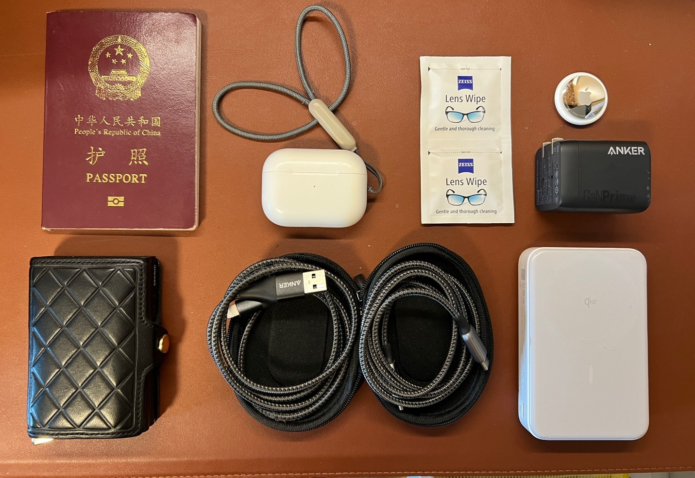
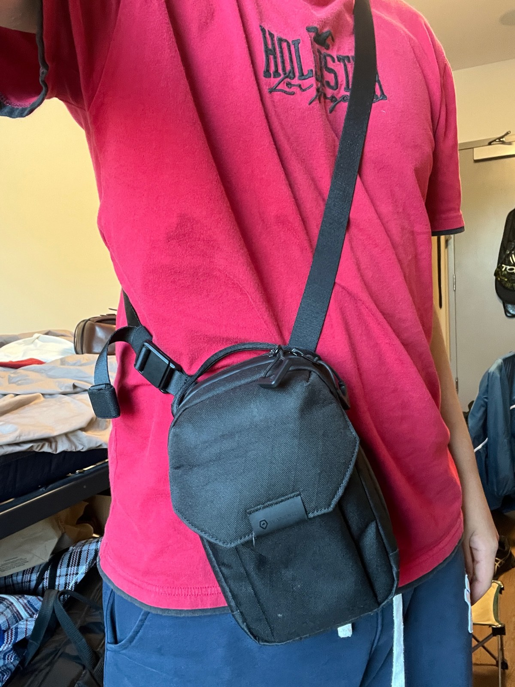
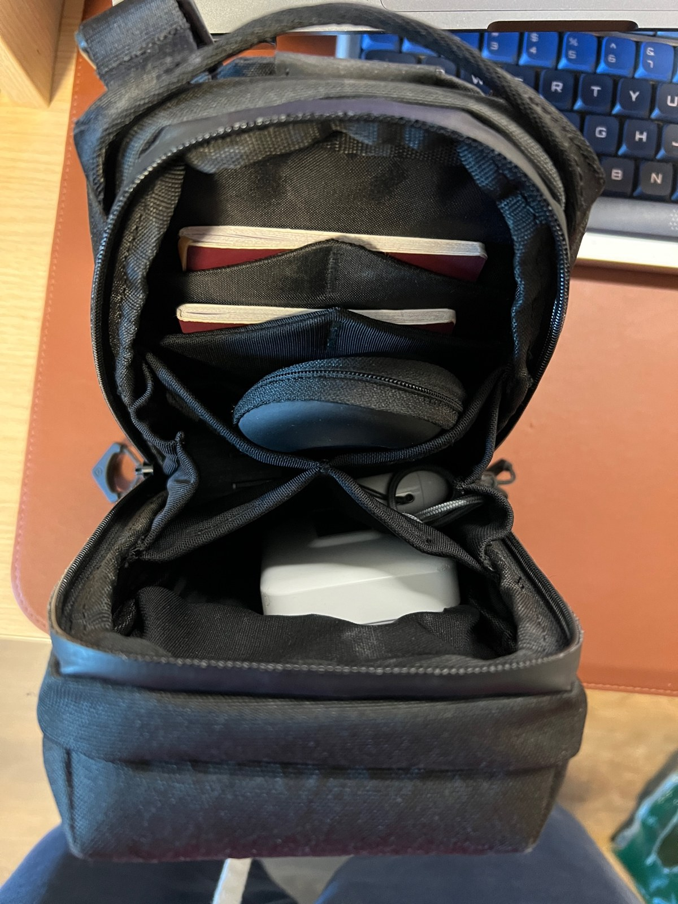

_This post isn’t sponsored by anyone, and it isn’t an ad for any of the brands below._

On every long-haul flight, there’s one bag I consider truly essential: my crossbody bag. It matters so much to my routine that it never goes in the overhead bin. Here’s what I carry in it, why, and what to look for if you want to try the same approach.

- [What’s in it](#whats-in-it)
- [Why?](#why)
- [What kind of bag to look for](#what-kind-of-bag-to-look-for)

## What’s in it

Whenever I travel anywhere beyond a short hop around the Northeast, my crossbody bag is **always** my personal item. It’s a WANDRD X1 Crossbody in medium, and this is what goes inside. I’ve added a short note to anything whose purpose isn’t obvious.

- **My passport.** It’s my only valid ID for flying.
- **AirPods Pro 2.**
- **Zeiss lens wipes**, for cleaning screens and my glasses.
- **A small cable case** with a USB-A to Lightning cable and a USB-C to USB-C cable. I still carry the Lightning one for two reasons. First, many older planes don’t have USB-C ports yet, and the power outlet isn’t always convenient (sometimes you have to share it with your neighbor). Second, my AirPods and iPhone still use Lightning.
- **A Secrid Twinwallet**, holding mostly credit and debit cards.
- **An Anker 10,000mAh MagSafe-compatible power bank.**
- **An Anker 65W charger with three ports (two USB-C, one USB-A).** It hits the sweet spot between too few ports and too little power to charge a laptop on one side, and a heavy brick on the other.
- **An AirTag**, just in case. That said, the bag rarely gets more than a meter away from me when I travel.

## Why?

When you travel, your ID, your money and your phone are probably the three things you’d least want to lose, or to have stop working. This bag holds all my cards and my passport, plus two ways to charge my phone: the charger when there’s a power outlet and the power bank when there isn’t. So even if I ended up with no other luggage at all, whether it was lost, stolen or somehow disintegrated, I could still get by.

## What kind of bag to look for

If you want to try my approach (and I highly recommend it), look for a small crossbody bag of roughly 1 to 2 liters. That’s small enough to keep at your seat in economy without eating into your legroom, and in premium cabins it fits in most of the storage compartments by the seat. At the same time, make sure it isn’t too flat, like a phone pouch, or it may not fit everything you want to bring. Here’s how big mine is when I wear it.

My WANDRD X1 in medium fits everything on the list without being too big. Here’s the inside: the main compartment holds everything except the wallet, which goes in the pouch in the front flap. That pouch is also designed to fit a pair of sunglasses in their case instead.

To sum up, my crossbody bag is quite literally my survival kit on long journeys, and I’d recommend trying this approach at least once.
