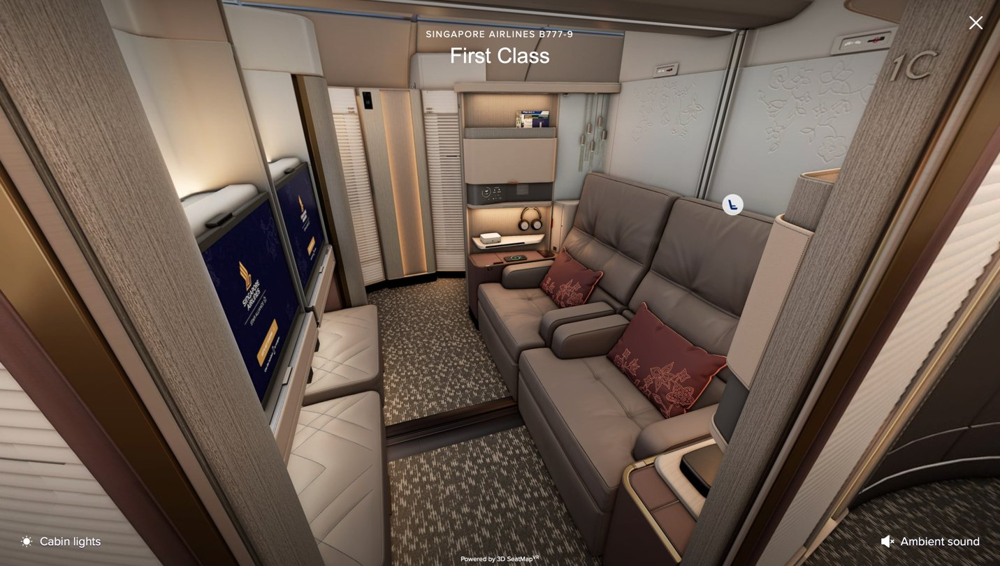
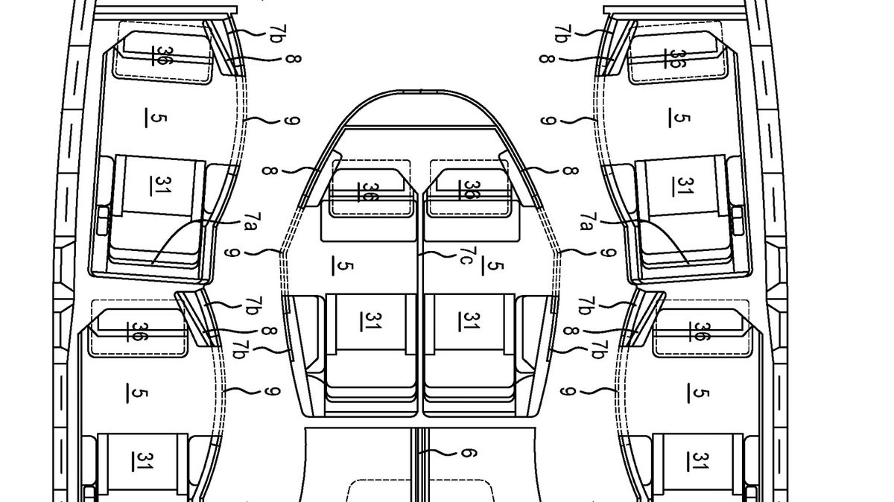
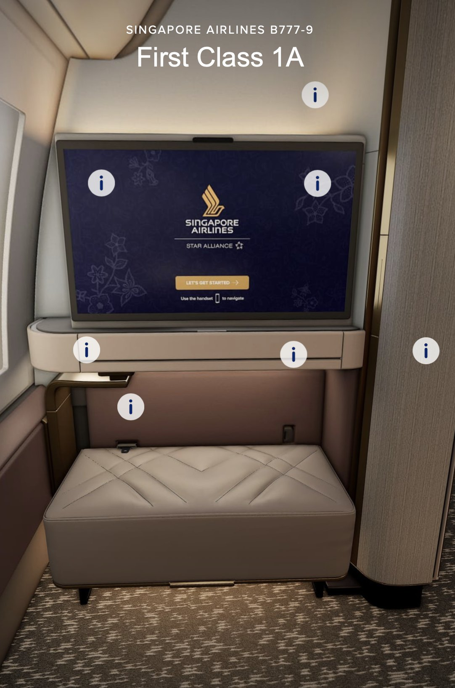
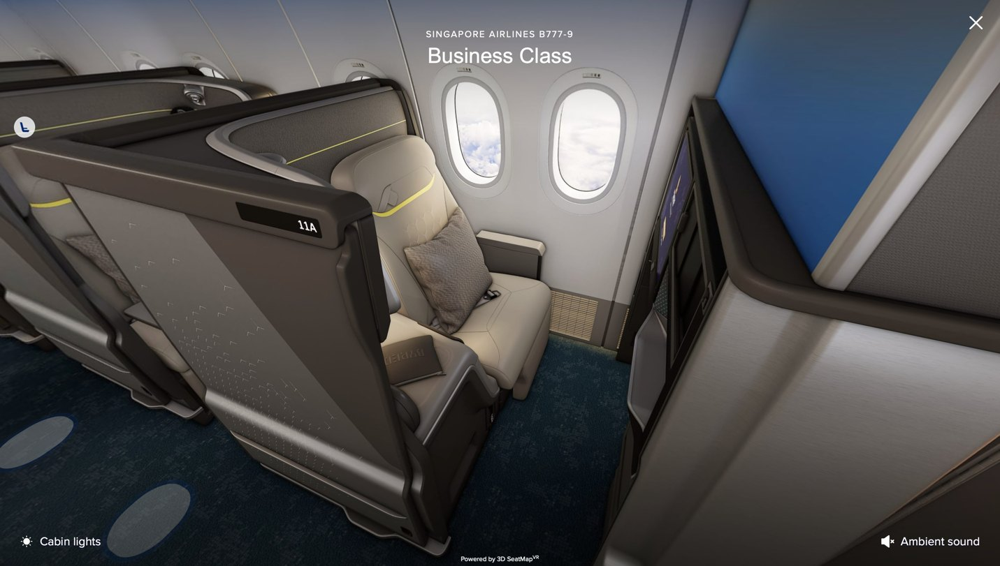
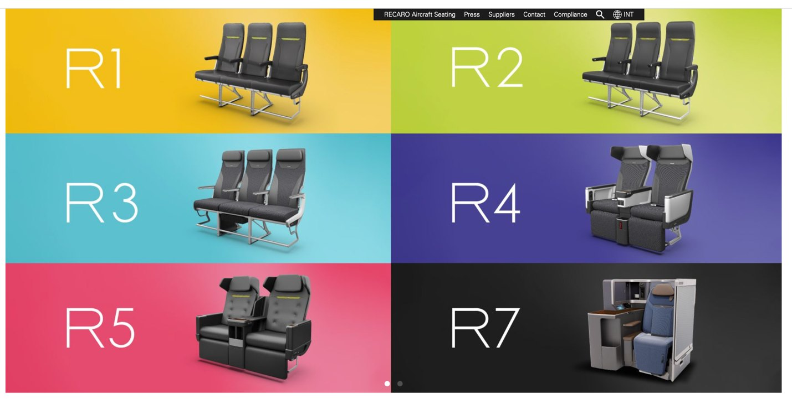
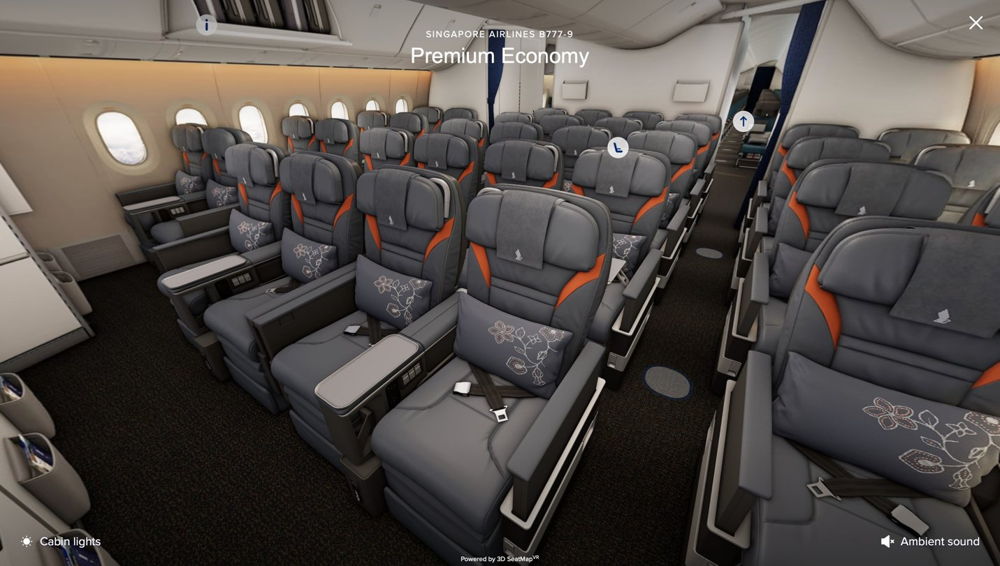
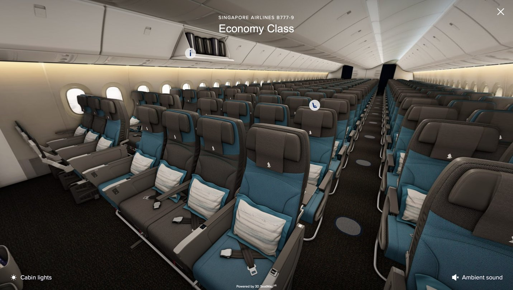

On November 6, Singapore Airlines unveiled its new cabins across all four classes: first, business, premium economy and economy. They’ll start flying from the second half of 2027. The new business class is going on the airline’s long-haul and ultra-long-haul Airbus A350-900s, first class on the ultra-long-haul A350s, and all four cabins on the long-awaited Boeing 777-9. The premium cabins are modern enough in how they work, but I couldn’t help being confused by the color palette, especially from a world-class airline like Singapore. Let’s go through them one by one.

_This post doesn’t cover every spec (seat pitch, width and so on), but those are easy to look up. All cabin pictures are screenshots from Singapore Airlines’ virtual tour of the new cabins._

- [First class](#first-class)
- [Business class](#business-class)
- [Premium economy and economy class](#premium-economy-and-economy-class)
- [Conclusion](#conclusion)

## First class

Visually, the new first class is by far my favorite of the four cabins. It keeps the warmth and elegance Singapore Airlines is known for. On the 777-9, the six suites are laid out in a slightly irregular shape so that each one is as wide as possible through the middle, as the patent drawing below shows.

On the ultra-long-haul A350-900s, meanwhile, there will be four suites in a more traditional layout. It’s the first time these jets will have first class at all. By the way, the new ultra-long-haul A350 configuration carries just 132 passengers, fewer than many A220s!

The center suites have a floor-to-ceiling partition that can be lowered to turn them into a double suite. I especially liked the front of the suite, shown below. Even if it isn’t the intention, the amenity drawer with its mirror and the generously sized ottoman make it look like a premium vanity set.

## Business class

Now on to the new business class.

The new business class suites use a standard staggered layout in a 1-2-1 configuration, with the middle pairs alternating between “honeymoon” seats (pushed together) and separated ones.

I have no complaints about how the seats work. I’m sure they’ll be at least on par with the best suites flying today, if not better. But I can’t get past the terrible color palette. Everyone is already making fun of it, but here’s something I noticed: go to the website of Recaro, which builds Singapore’s new business class seats, and you’ll see the same neon yellow stripe on its R1, R2 and R5 seats. So it looks like it’s some sort of family design on Recaro’s stock seats, and practically every airline, even the ultra-low-cost ones, at least puts its own colors on them.

Here’s the problem: Singapore Airlines says it worked with Designworks, BMW Group’s design studio, on the business class design. _What have they done?_ The seats look literally like Recaro’s stock mock-ups.

## Premium economy and economy class

Premium economy is where the least has changed, and frankly, given the designs elsewhere, that might not be a bad thing. The seat pitch goes up slightly, and apparently the cocktail table is bigger too, both of which I appreciate.

The economy class colors, on the other hand, throw me off again. The half-blue seats look like something from a Caribbean or European leisure airline, and nothing like any of the other cabins. Seriously?

## Conclusion

To sum up, the new cabins are up to date in how they work, but Singapore Airlines really disappointed with its colors, which matter about as much as anything in cabin design. First class and premium economy do a decent job of keeping Singapore’s traditional look, but business class and economy, the two cabins with the most passengers on almost any flight, get a bland palette and a flippant one, respectively. It would already be bad if a whole plane looked like either of them. But these four cabins will soon share the same jet, with this much inconsistency between them. Oh my gosh…

If you’ll be flying on these jets from next year, I recommend wearing an eye mask until you’re seated. That way, at least you can watch a movie on the screen instead of judging Singapore Airlines’ abysmal design choices.
