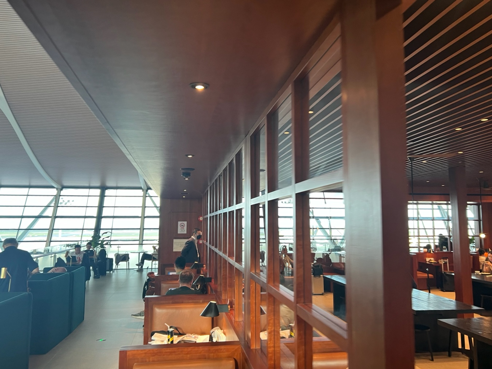
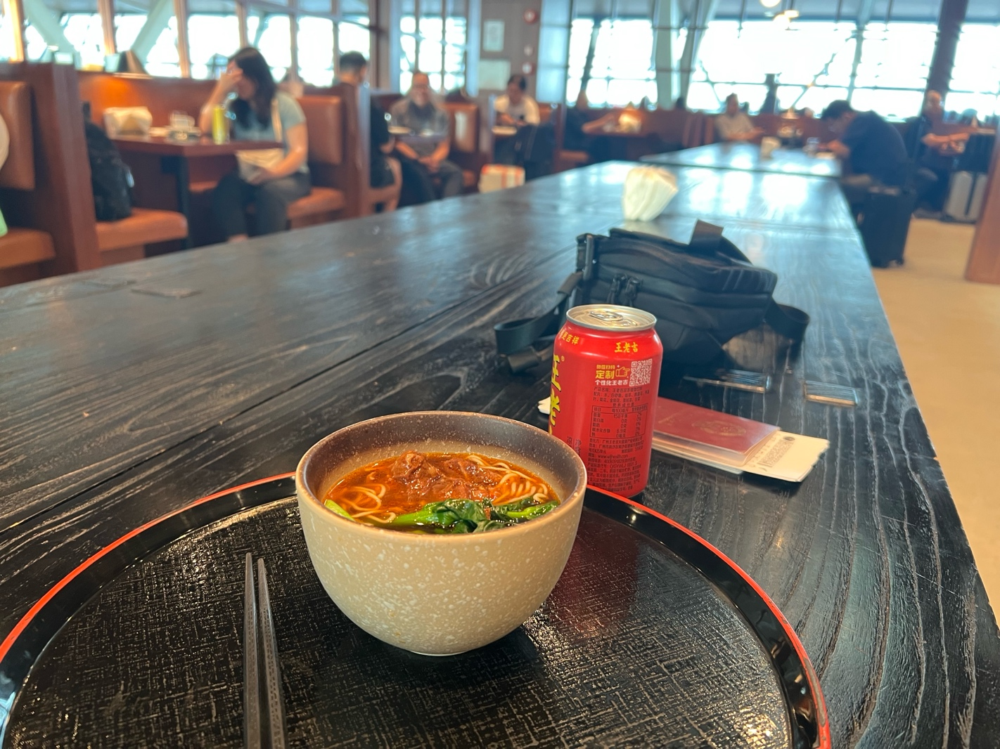
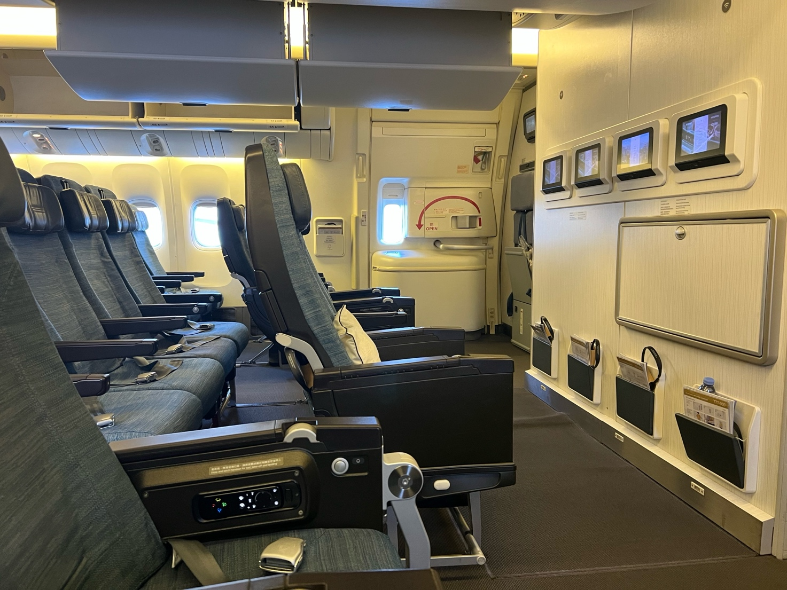
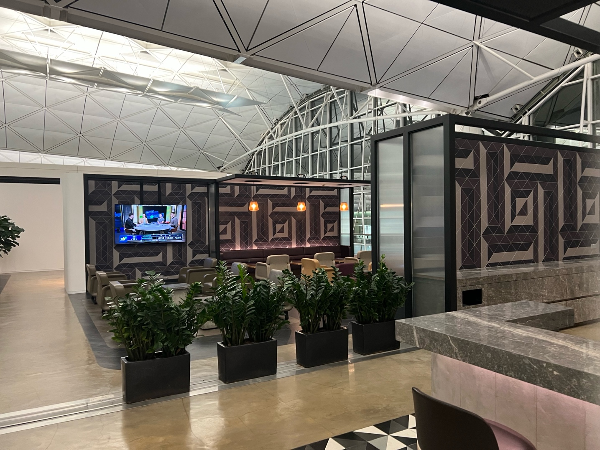
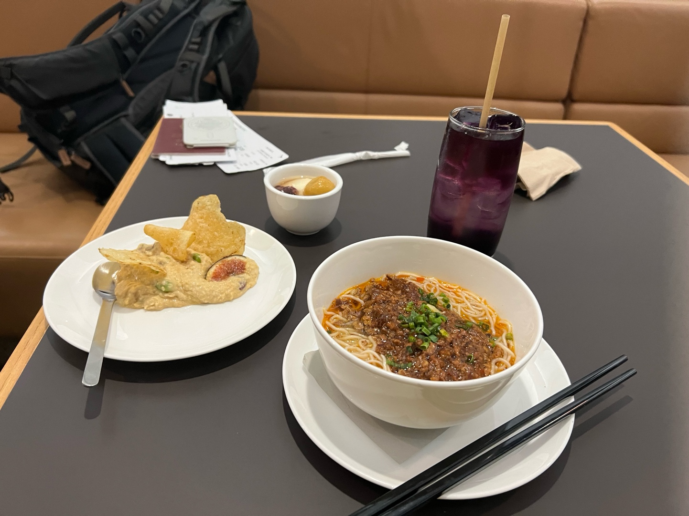
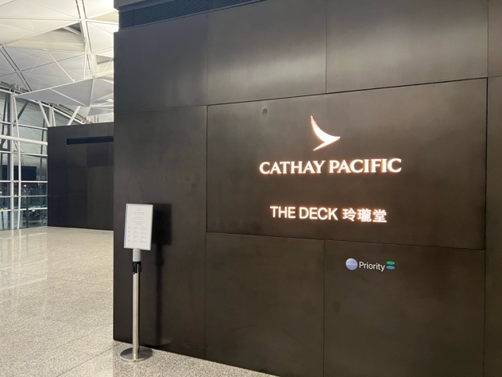
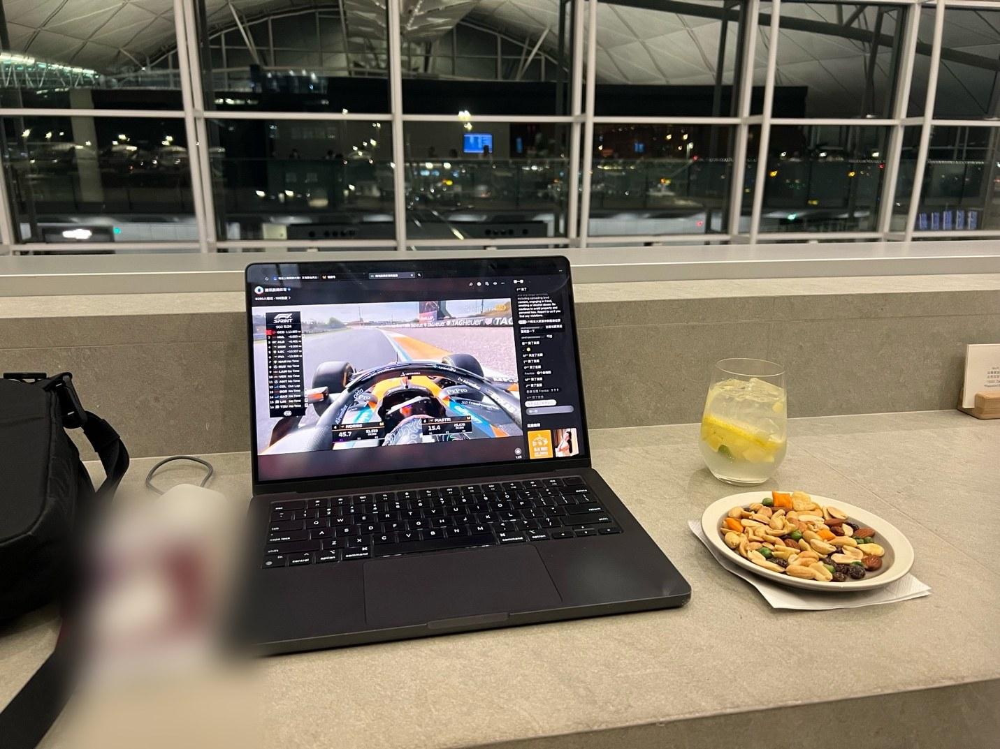
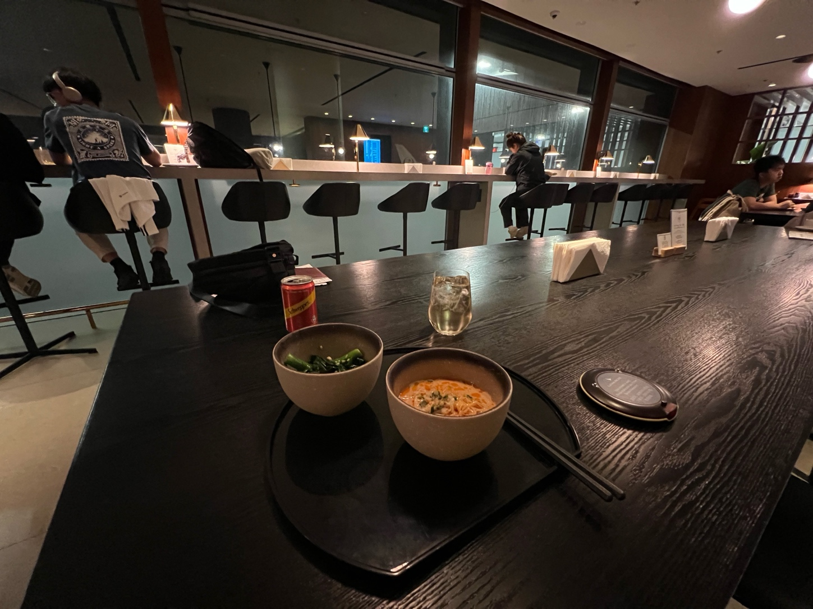
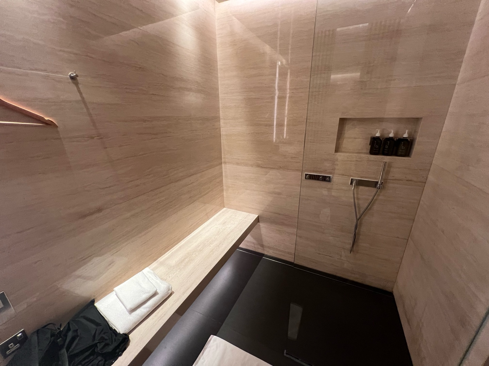
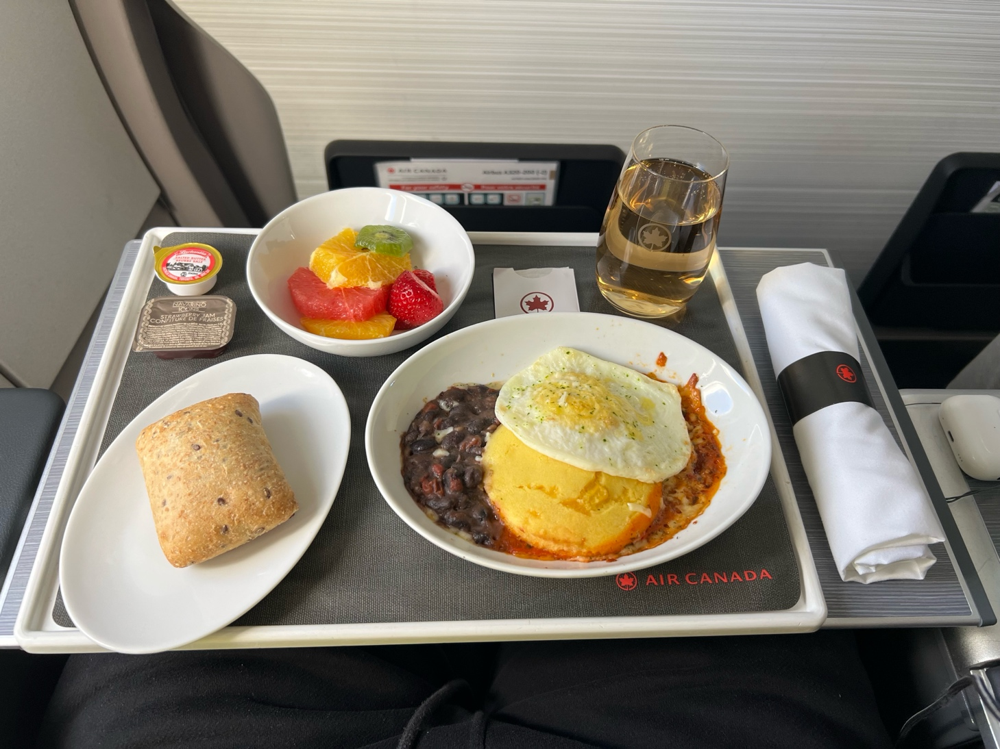

It’s that time of year again: school is starting. Unlike the past two years, I didn’t visit Europe before heading back, so this time it was a longer trip straight back to school.

**In this report:** [How I booked](#how-i-booked-this-trip) · [Departure from Shanghai](#departure-from-shanghai) · [Cathay lounge, Shanghai](#the-cathay-pacific-lounge-shanghai) · [CX 369 to Hong Kong](#shanghai-to-hong-kong-cx-369-in-economy) · [Transfer in Hong Kong](#transfer-in-hong-kong) · [Qantas lounge](#the-qantas-lounge-hong-kong) · [The Deck](#the-deck) · [The Bridge](#the-bridge) · [CX 820 to Toronto](#hong-kong-to-toronto-cx-820-in-business-class) · [Transfer in Toronto](#transfer-in-toronto) · [AC 1502 to Newark](#toronto-to-newark-ac-1502-in-business-class) · [Arrival in Newark](#arrival-in-newark) · [Conclusion](#conclusion)

## How I booked this trip

I usually book trips many months in advance, and I had originally booked a round trip with Cathay Pacific in premium economy, from Shanghai to New York JFK via Hong Kong: back to school at the start of the year, and home again for Thanksgiving break. But about a month before departure, Philippine Airlines started releasing transpacific business class award seats to Atmos Rewards. I cancelled my original itinerary and booked one of those for the long-haul part of my Thanksgiving trip home, which left my trip back to school unsettled.

After a bit of fare searching, I booked this itinerary on Cathay Pacific’s website for most of the trip:

- **August 21:** CX 369, Shanghai to Hong Kong, economy, Boeing 777-300, 17:40–20:30
- **August 22:** CX 820, Hong Kong to Toronto, premium economy, Airbus A350-1000, 02:50–05:45

This one-way ticket cost $1,964, which I’d consider poor value for a one-way transpacific premium economy fare, but it was the best I could find within oneworld just a month before departure.

My Philippine Airlines ticket home for Thanksgiving also leaves from Toronto, so I booked a separate Air Canada ticket covering both of those connections:

- **August 22:** AC 1502, Toronto to Newark, business class, Airbus A320, 08:20–10:00
- **Thanksgiving:** a flight from New York back to Toronto, economy

That ticket cost $595. I don’t really need business class on a short transborder hop like this, but when I booked, economy was barely cheaper than business on this leg, so I treated myself to a cheap upgrade.

## Departure from Shanghai

I arrived at Terminal 2 of Shanghai Pudong about two hours before departure and headed to Cathay Pacific’s check-in area, where my oneworld Sapphire status let me use the business class counters. The agent was also able to print my Air Canada boarding pass separately, but wasn’t sure whether my bags could be checked all the way through. Check-in was quick, and so was passport control, thanks to the automated e-gates. Security, however, had a long line that took me 15 to 20 minutes. Fortunately, I’d left myself enough time that it didn’t matter.

After security, I went to see a friend who was about to board a Hong Kong Airlines flight to Hong Kong to take the SAT. That flight left from satellite terminal S2, so it took a while to get there, but it’s always good to see friends at the airport. Then I took the people mover back to the main terminal and headed to the Cathay Pacific lounge.

## The Cathay Pacific lounge, Shanghai

Oddly enough, this was my first ever visit to this lounge, despite being a oneworld elite based in Shanghai.

The lounge was quite crowded when I arrived, but I grabbed a seat at the end of a long communal table and headed to the noodle bar for a bowl of braised beef noodle soup. It was decent, but not quite at the level of Cathay’s dan dan noodles, which I’d be enjoying in Hong Kong later.

Once I’d finished my noodles, it was time to head to my flight to Hong Kong.

## Shanghai to Hong Kong: CX 369 in economy

Boarding was delayed, and I ended up boarding with group 2 only five minutes before our scheduled departure time. We pushed back 30 minutes late, then taxied for another 30 minutes, so we took off almost an hour behind schedule. With a five-hour layover in Hong Kong, that didn’t matter to me.

I’d picked a window seat in the bulkhead exit row; economy on this 777-300 is laid out 3-4-3. The window here is tall and narrow to fit the shape of the emergency exit. The downside is a narrower seat, because the tray table is stowed in the armrest instead of the seatback in front, as it is in every other row.

I skipped the meal, since I’d just had noodles and plenty of better food was waiting for me in Hong Kong’s lounges.

## Transfer in Hong Kong

We arrived in Hong Kong half an hour late. The nearer transfer area was crowded, so staff were sending people to the one farther away. On the way, I spotted a Cathay transfer counter and asked whether I’d need to collect my bags in Toronto, since I already had my Air Canada boarding pass and my bags were tagged through to Newark. The agent said no. (That turned out to be wrong.)

The surprising news, though, was that premium economy was oversold and I’d been upgraded to business class. I was absolutely ecstatic. Suddenly that sub-$2,000 fare was a GREAT deal!

The farther transfer area was still busy, and it took about 20 minutes to get through to the main terminal. From there, I headed to the Qantas lounge.

## The Qantas lounge, Hong Kong

This lounge is very hard to find on your first visit. I could see it right next to The Deck, but the two are reached in completely different ways. To get to the Qantas lounge, I had to take a detour up a level, then spot a walkway so narrow it probably doesn’t fit two people side by side, before I finally reached the reception.

The lounge was fairly empty when I arrived around 10 pm (it closes at 11:30). Dan dan noodles were on offer, which surprised me: they’re arguably the signature dish of Cathay’s lounges, and I’d have expected Qantas to try harder to set itself apart. From what I could tell, the Qantas version uses a lighter broth instead of Cathay’s sesame-heavy one, and it’s topped with some minced meat. I still prefer Cathay’s. I also had some hummus with chips and a butterfly pea mocktail.

I stayed until the lounge began closing down, then went to visit The Deck next door (via that same detour). It was the only Cathay business class lounge in Hong Kong I hadn’t been to yet, apart from The Wing, Business, which was closed for renovation.

## The Deck

I got to The Deck around 11 pm and was shocked when the reception told me it was extremely full and suggested I try other lounges. Given how small the lounge is, that made some sense, but I was still surprised with an hour and a half left before closing.

I explained that I’d come specifically for The Deck, and after a walk around I managed to grab a seat on the outer edge of the terrace. Having just eaten at the Qantas lounge, I wasn’t hungry, so I ordered a lemon soda-style mocktail and watched a Formula 1 qualifying session on my laptop.

The crowd only started to thin out about 30 minutes before closing. I left about 10 minutes before closing time and set off on a long walk across the whole terminal to The Bridge, at the far end.

## The Bridge

At The Bridge, I turned left and left my bags in the storage locker room. Before going into detail, here’s why I personally think The Bridge is by far the worst Cathay lounge in Hong Kong, even though it’s the only one guaranteed to stay open until the last flight of the day.

The biggest problem is the split layout. The showers and the noodle bar are on one side, while the bar and some quieter areas are on the other. Nothing stops you from carrying things between them, but I can’t imagine many people enjoy being stared at as they walk through the reception, the only way across, holding a drink or a bowl of noodles. Since plenty of people naturally want a drink with their hot food, I think it’s a terrible design on Cathay’s part.

Anyway, after settling into the left half of the lounge, I went to the shower reception to freshen up before the flight and was told the wait was about an hour. That was surprising again at almost 1 am, but my flight wasn’t until nearly 3, so I wasn’t in a rush. While I waited, I treated myself to another bowl of dan dan noodles (yes!) with some greens.

In the end, I waited about 40 minutes, a little less than expected. The shower room was as nice as ever, with all the usual amenities, including Bamford shampoo, conditioner and body wash. A hot shower before a late-night long-haul flight is always a treat!

By the time I’d finished, it was time to board my flight to Toronto.

## Hong Kong to Toronto: CX 820 in business class

For the full story of my upgraded flight to Toronto, see my [detailed review of Cathay Pacific’s A350-1000 business class](/reviews/cathay-pacific-a350-1000-business-hkg-yyz/).

## Transfer in Toronto

My connection in Toronto was tight. In two and a half hours, I had to clear Canadian customs, collect and recheck my bags, change terminals, and then clear US Preclearance.

Canadian customs was quick, and I had both of my bags about 40 minutes after landing. I then went from Terminal 3 to Terminal 1, rechecked my bags and cleared US Preclearance. By the time I reached the US departures area in Terminal 1, boarding was only about 20 minutes away. I’d hoped to take a quick look at the Maple Leaf Lounge, but when the elevator doors opened, the line was so long it was literally blocking people from getting out. It was borderline scary, and, amusingly, everyone in the elevator rode straight back down together.

So I went straight to the gate, and about 30 minutes before departure, it was time to board my Air Canada flight to Newark.

## Toronto to Newark: AC 1502 in business class

For business class between the US and Canada, Air Canada is by far the better choice. It offers lounge access and a hot meal on virtually all mainline flights, not just those of three hours or more, and no US airline offers either on these flights.

I boarded with group 1, and boarding took quite a while as we waited for some passengers whose previous flight was delayed. We pushed back at 8:45 am, about 25 minutes late.

The business class seats on this A320 are the usual domestic first-style recliners in a 2-2 layout: certainly comfortable enough for a short hop, but not much to talk about.

I’d preordered the huevos rancheros (the other option was a cold breakfast), and it was really tasty, served with bread and fruit. I love creative breakfasts on board, since far too often planes serve a poorly done English breakfast. Compare that with a US airline’s domestic first class on a flight this length, where you might not even be offered the snack basket!

Overall, this short business class hop with Air Canada was definitely enjoyable, especially compared with the competition.

## Arrival in Newark

We landed at Newark just after 10 am, about ten minutes behind schedule. After picking up my bags, I found I’d just missed the NJ Transit train. Since I couldn’t be late for the time I had to be back at school, I had to take a rather expensive Uber to finally get there.

## Conclusion

I’d rate this routing about 7/10 for getting back to school. Hong Kong has plenty of great lounges that I have access to, but connecting in Toronto between separate tickets can be tricky, especially if you’re not a seasoned traveler. I’d recommend leaving at least 3.5 hours between an international arrival and a US-bound departure when you have to change terminals on separate tickets, as I did this time.

Overall, it was a fun trip back to school. The highlights were lounge hopping in Hong Kong, the surprise upgrade on the long-haul flight, and a short transborder hop that was far better than the competition. It was a very pleasant journey, and I arrived reasonably well rested for the new school year.
