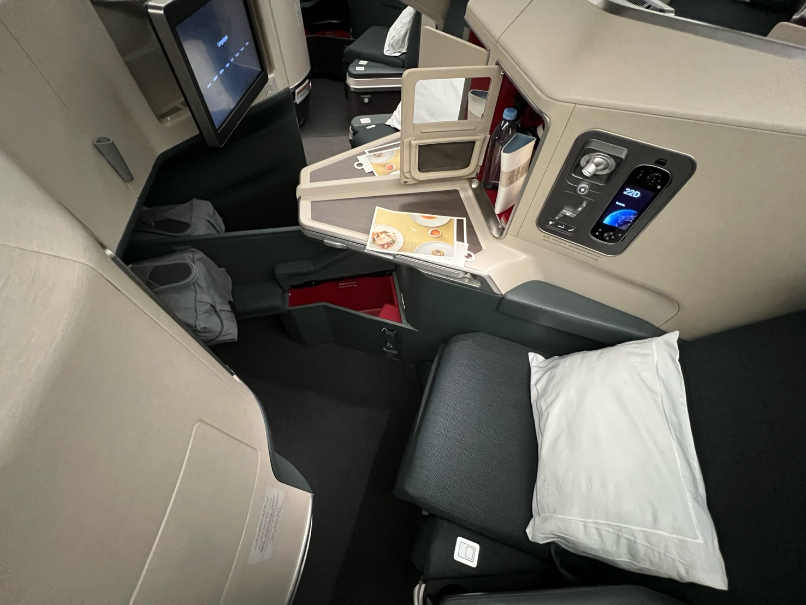
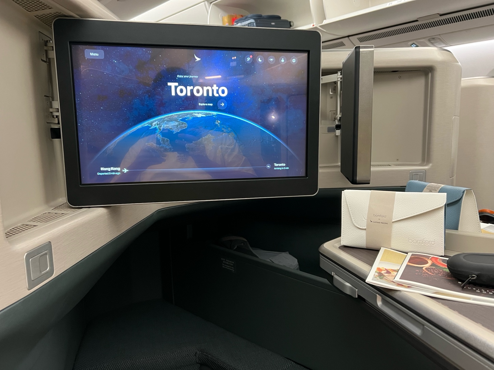
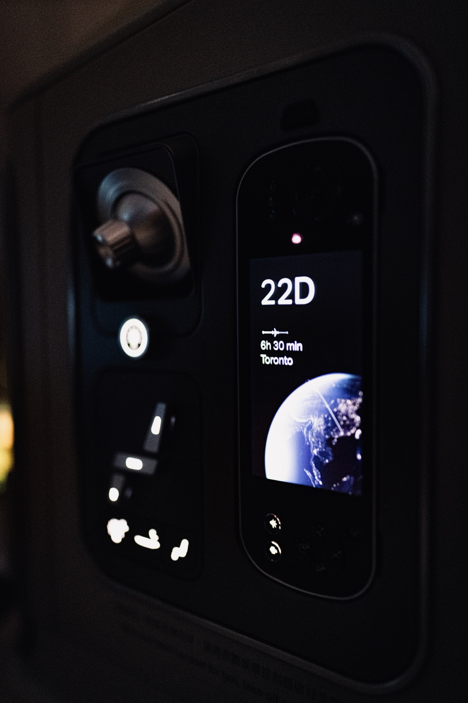
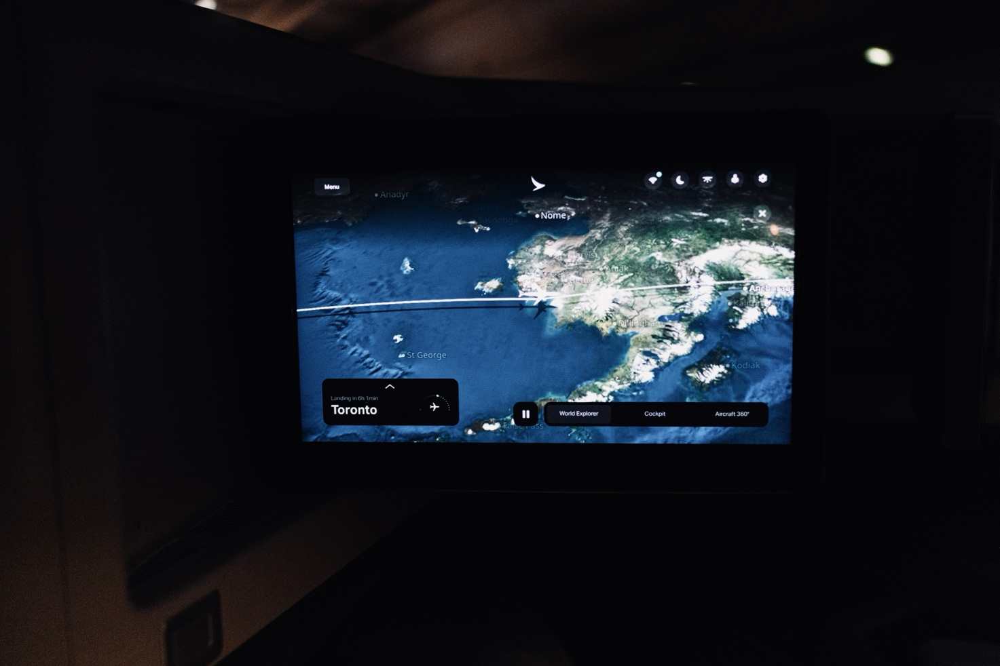
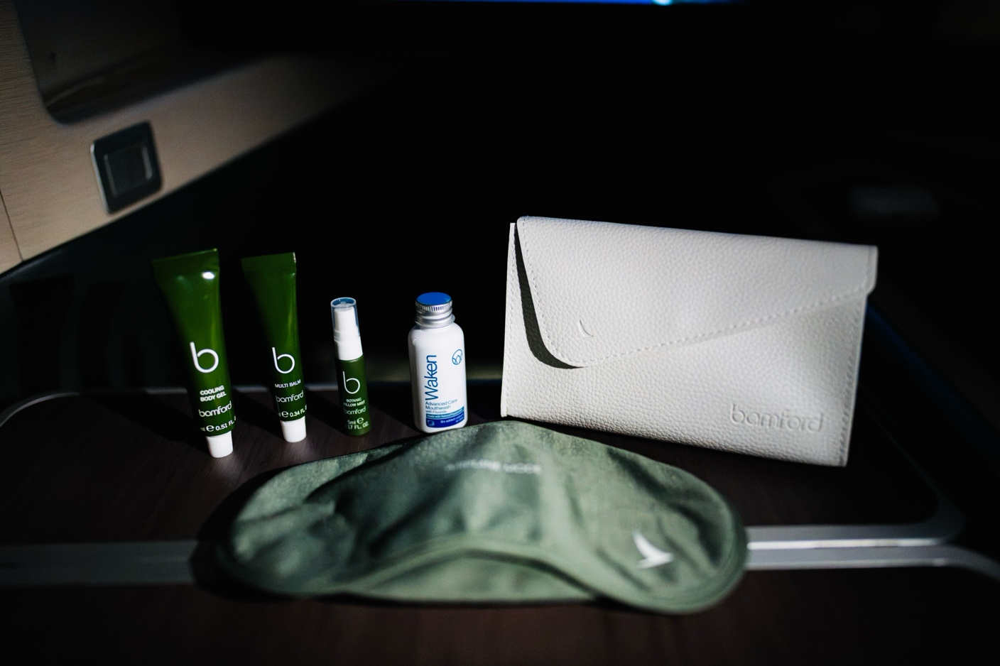
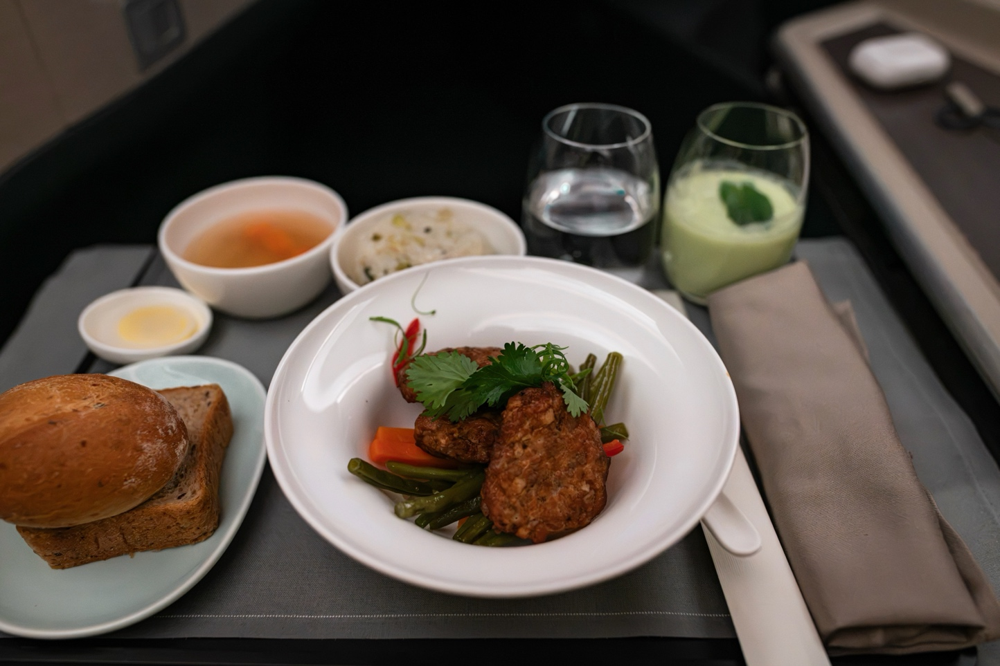
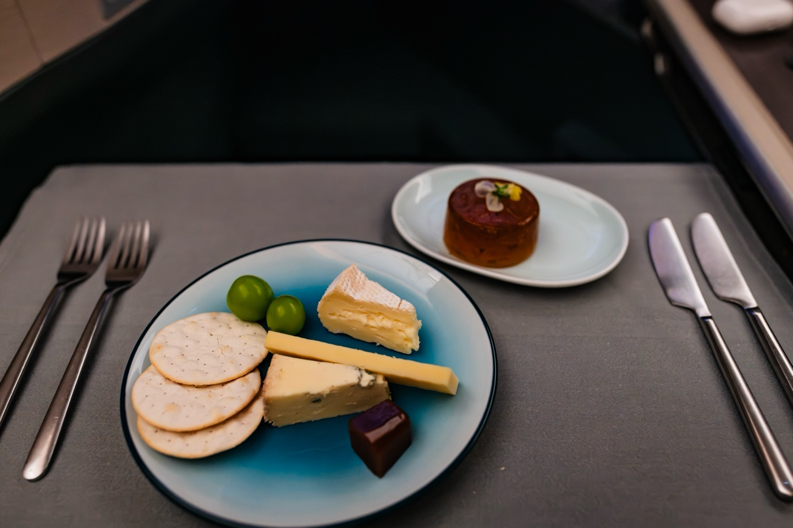
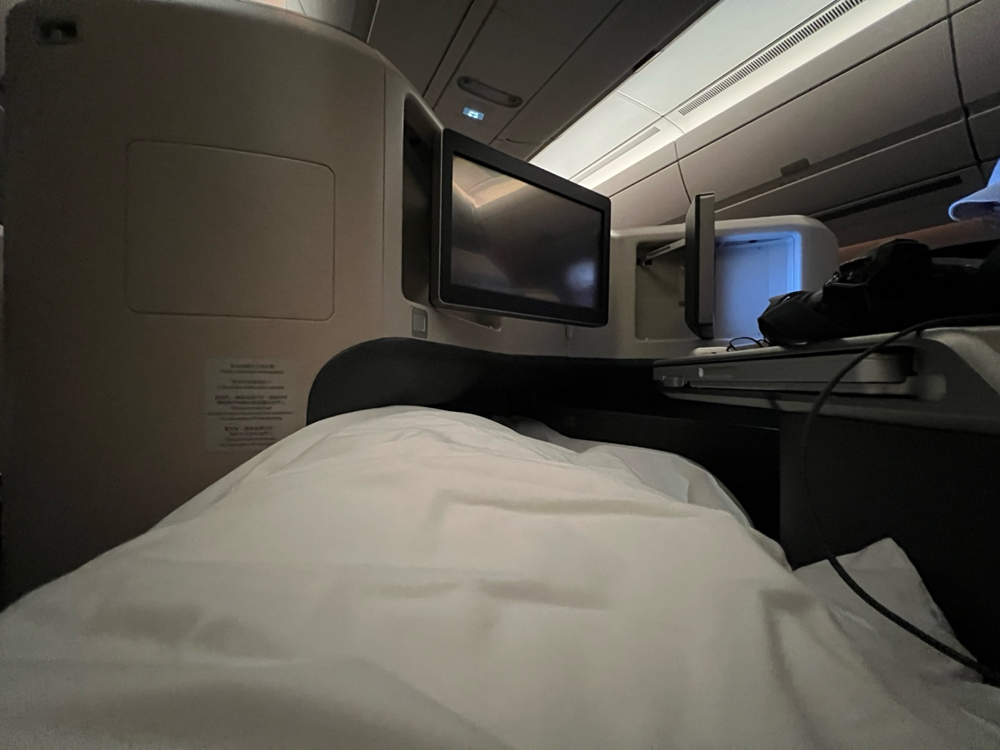
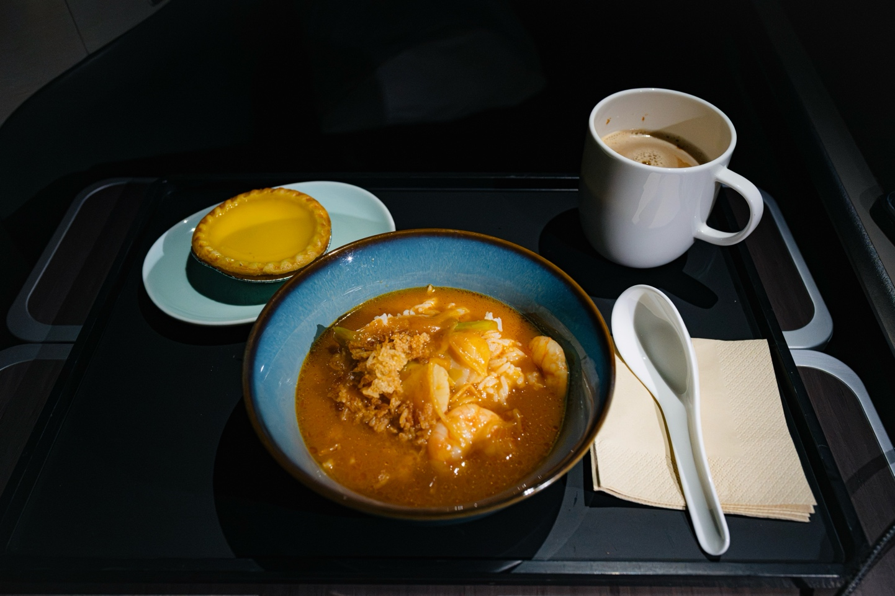
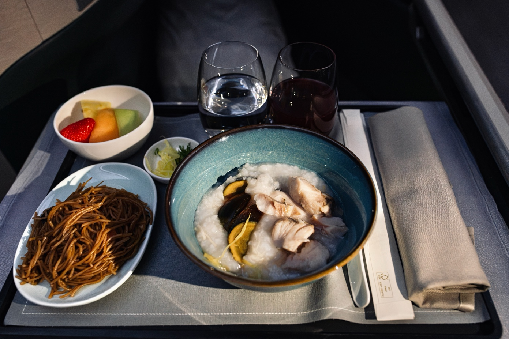

Welcome on board Cathay Pacific’s Airbus A350-1000 in business class, flying from Hong Kong to Toronto. This one was a pleasant surprise: as I explain in the [trip report](/reviews/back-to-school-august-2026/), premium economy was oversold, and I was upgraded to business. Cathay was one of the few big oneworld airlines whose long-haul business class I’d never found an easy way to book cheaply, so the upgrade also ticked off another box for me.

The short version: Cathay’s A350-1000 business class is among the best of the previous-generation business class seats, the food is great (the à la carte snack was the highlight), and the service was as consistent as it always is on Cathay. It’s never over the top, but never underwhelming either.

**In this review:** [Boarding](#boarding) · [The seat and cabin](#the-seat-and-cabin) · [Amenities](#amenities) · [Welcome and departure](#welcome-and-departure) · [Dinner](#dinner) · [Sleep](#sleep) · [The mid-flight snack](#the-mid-flight-snack) · [Breakfast](#breakfast) · [Arrival and verdict](#arrival-and-verdict)

## Boarding

All the other lounges had already closed before this late-night departure, so I waited in The Bridge, my least favorite oneworld lounge at Hong Kong. When boarding started, I headed to gate 50 and boarded with group 2 through the first door.

## The seat and cabin

Cathay uses a customized version of the Safran Cirrus III seat, which I consider one of the best previous-generation business class seats. Among those, I usually prefer the Super Diamond, since you don’t have to swing the screen around to face you, but otherwise Cathay has done a good job of making this seat feel as spacious as possible within its footprint.

I was in 22D, the middle seat on the left side of the last row. When I’m traveling alone I normally aim for a window, but on an operational upgrade you don’t get to choose (and I’m not complaining!). One downside of the middle seats is that there’s no privacy divider between them. In fact, my neighbor across the center console and I felt around everywhere in the seat and couldn’t find one. That said, the console sits far enough forward that in a normal sitting position you can’t see the person next to you anyway, which is good or bad depending on whether you’re traveling with someone.

Beside the seat, a side panel holds the entertainment remote, which has its own 4-inch screen (I love that it doubles as a vertical flight-progress display when it’s docked), along with a reading light and the seat controls.

There’s also a small closed cabinet holding a bottle of water and the headphones. I appreciated the mesh pocket on its door, which turned out to be the perfect place for my flight log. A bifold tray table folds out from the console.

As for the entertainment screen itself, the 18-inch HD monitor is stowed at an angle by default, so you press a button and swivel it to face you. The mechanism on my seat was a bit stiff, but I could still manage.

Between the center console and the ottoman there’s a right-angled cutout, which Cathay designed as a storage space (great for my crossbody bag), and which also gives side sleepers a little extra knee room. On the aisle side there’s an armrest you can lower, with a spot for a water bottle inside it, and right beside it a narrow strip of extra sleeping surface that extends at the push of a button.

Finally, Wi-Fi is free for the whole flight in business class, which I really appreciated.

## Amenities

Business class came with a Bamford amenity kit and a substantial bedding set, both of which are pretty much expected on any transpacific business class flight these days.

The kit comes in Cathay’s classic faux-leather pouch, stocked with a dental kit, an eye mask, earplugs and mouthwash, plus Bamford’s multi-balm, cooling body gel and pillow mist.

The bedding includes a large pillow and blanket, plus a mattress pad that slides over the headrest to hold it in place. A pair of slippers was provided too.

## Welcome and departure

Once I’d settled in, I was offered a welcome drink and picked orange juice. At the time, I was just under a month away from being able to enjoy a glass of champagne.

We had a surprisingly long taxi out of Hong Kong, over half an hour, which I didn’t expect at 3 am. There isn’t much to say about the takeoff itself; given the hour, I think I dozed off shortly after.

## Dinner

Dinner was served after takeoff, even though by then it was closer to an early breakfast than a late dinner. There was no separate starter or salad course, since nobody is looking for a gourmet meal that late at night.

The menu offered three lighter dishes for anyone too tired to sit through a full dinner, plus two more substantial mains: pan-fried pork patties with lotus root and water chestnuts, served with rice and soup and created with Duddell’s, and lamb shoulder confit with couscous and salad, created with Louise. I went for the pork, with a Cathay Delight to drink. Bread was offered shortly after my tray arrived.

Overall, the meal was satisfying without being too heavy for such an awkward hour. As someone from Shanghai, I especially liked the Shanghai vegetable rice, which was about as authentic as it gets on a plane.

Cheese and dessert came next, and I said yes to both. The dessert was a tea-flavored jelly of some sort, which I found rather bland. The cheese, surprisingly, was quite good, and for some reason I especially liked the sweet paste served alongside it.

Because everything came on a single tray, dinner was over a little more than an hour after takeoff. I appreciated that it didn’t keep me awake: a very decent meal that still let me fall asleep straight afterwards.

## Sleep

After dinner, I made up the bed and quickly fell asleep.

The bed was quite comfortable, and since I was also exhausted, I slept for six and a half hours, which I’d call beyond excellent on a plane.

## The mid-flight snack

Between the two meals, Cathay offers an à la carte menu of lighter dishes you can order any time. When I woke up, I ordered the seafood broth rice (also one of the three lighter dishes at dinner) and an egg tart, with a mug of Hong Kong milk tea.

I was very impressed by this snack, and I’d call it the best of my three meals on this flight. The seafood broth rice was comforting and exactly what I needed in the middle of the flight. Given the choice, though, I still prefer flaky Macau-style egg tarts.

## Breakfast

Breakfast started about two hours before landing, just before 4 am Toronto time. I chose the congee with century egg and fish, which came with stir-fried noodles, some fruit and a “fruit smoothie.” I found the smoothie odd: there’s no milk or yogurt in it, so it’s really more of a mixed juice. The congee was more flavorful than I expected, though I added too many slices of ginger and ended up picking them out toward the end. The noodles were fine but forgettable.

## Arrival and verdict

We touched down at 5:41 am Toronto time, about five minutes behind schedule. After a short taxi we pulled into Terminal 3 at Toronto Pearson, where I cleared customs and transferred to Terminal 1 for my Air Canada flight to Newark.

Between the solid hardware and the authentic, comforting food, Cathay’s long-haul business class on the A350 is among the better (though not the very best) business classes across the Pacific, and I’d gladly fly it again. The catch is that outside of Cathay’s own Asia Miles, getting a cheap business class fare can be difficult, so I expect it’ll be quite a while before I get another chance at Cathay long-haul business.
