Welcome aboard Philippine Airlines’ A350-1000 in business class, from Toronto Pearson to Manila. This was the main long-haul flight of the homeward half of my Thanksgiving trip. I booked it with 85,000 Alaska Atmos Rewards points. Philippine Airlines often has great cash fares, but this time they weren’t attractive enough, and I ended up getting roughly 4 cents of value per point, which I consider great.

I was going in with fairly modest expectations, even though this was a long-haul flight in a brand-new business class. From reviews I’d read online and the general impression I had, I thought of Philippine Airlines as more of a value carrier (if still full service), so I naturally expected less than from, say, a Japan Airlines or Cathay Pacific long-haul premium cabin. Walking off the plane, though, I’m delighted to report that Philippine Airlines’ business class comfortably beat my expectations, especially on food: it served some of the best main courses I’ve ever had on a plane. The hardware was modern (if not top tier), and while there were a few misses, they were scattered across the flight rather than concentrated in one area.

**In this review:** [Boarding](#boarding) · [The seat and cabin](#the-seat-and-cabin) · [Amenities](#amenities) · [Welcome and departure](#welcome-and-departure) · [Dinner](#dinner) · [Sleep](#sleep) · [The mid-flight snack](#the-mid-flight-snack) · [Breakfast](#breakfast) · [Arrival and verdict](#arrival-and-verdict)

## Boarding

After a shower at the Plaza Premium Lounge, I headed to the gate. Unfortunately, I’d missed priority boarding, and once economy is called there’s physically no separate priority lane anymore. I don’t know whether that’s down to Philippine Airlines or Toronto airport. When I showed the gate agent my boarding pass, she asked a colleague to walk me past the line to board, which felt like an awkward interaction that could be handled better.

The jet bridge was also somehow extremely hot, despite it being late November in Toronto. The group in front of me joked, “Ugh, I didn’t know we’d already landed in the Philippines!”, which I thought was funny and spot on. Only the second door was connected for boarding, so that’s where I got on.

## The seat and cabin

On the A350-1000, Philippine Airlines uses the Collins Aerospace Elevation seat in business class. Note that this is completely different from (and better than) the staggered business class on its A350-900s. The Elevation is essentially an upgraded version of the classic Collins Super Diamond, most importantly now with a door.

As the photo below shows, there are no overhead bins in the middle of the cabin. I’ve never been a fan of this design choice. It does make the cabin feel airier, but the center ceiling is already much higher than the sides, and in business class I like to put my bedding up top when I’m not using it, on top of my backpack. So I think the lost storage space matters, even though fewer people share each bin in premium cabins.

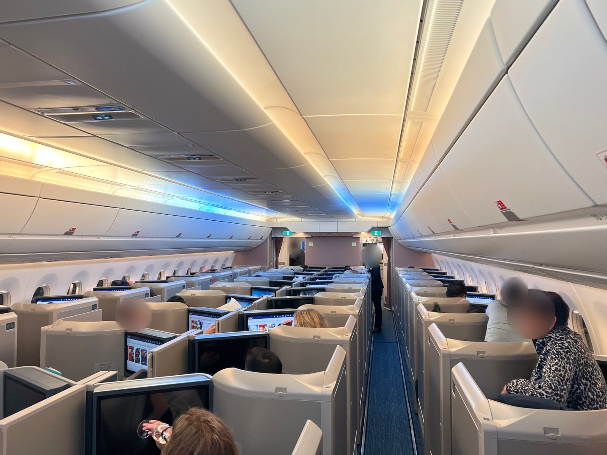

I was in 4K, the window seat on the right side of the fourth row. The seat was spacious enough, but nothing special. Beside the seat there’s a reading light, a literature holder with the safety card, and a lamp. The console has the two classic irregularly shaped storage compartments, identical to the Super Diamond’s. The shallower one, closer to the seat, has a large mirror on the back of its lid, while the deeper one holds the USB ports and the entertainment remote. Note that the power outlet is *not* in the deeper compartment, where many Super Diamond seats have it. Instead, it’s further down, on the wall above the life jacket, and it took me a good 30 seconds to find.

The seat is controlled from a small touchscreen just below the deeper compartment, again laid out like the Super Diamond’s. In front of that compartment is a wireless charger, where I kept my AirPods case for the whole flight. Below that panel is a small storage area that I didn’t end up using.

The seats also have a fixed three-point seatbelt rather than a detachable shoulder strap, so they work more like car seatbelts.

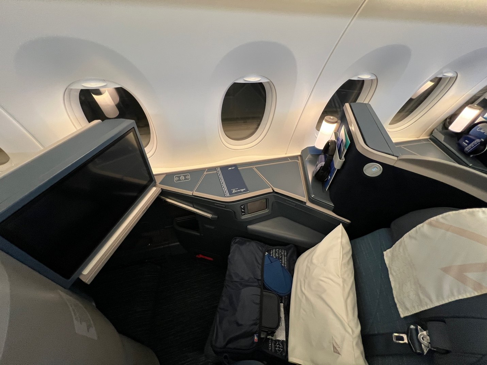

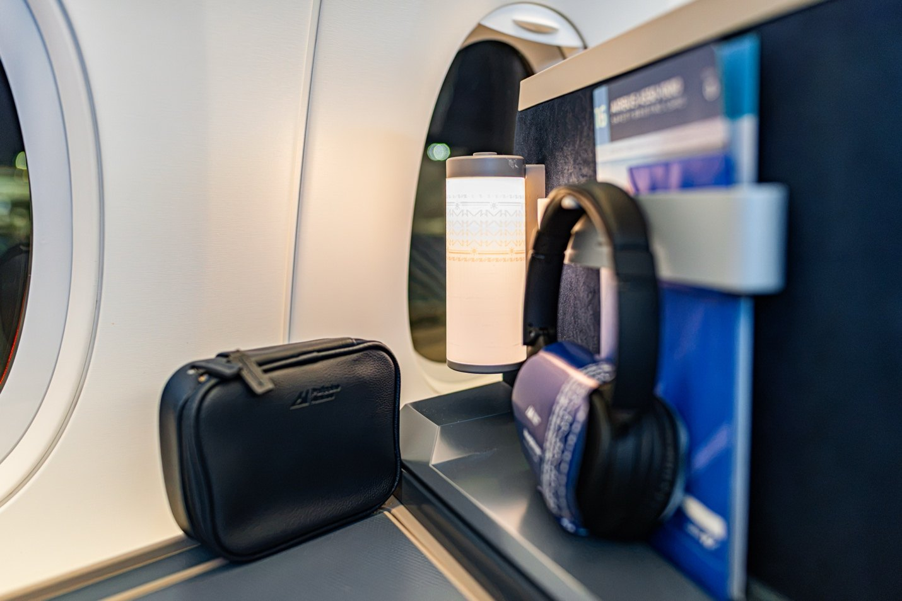

In front of you is a 20-inch 4K screen, and just below it is the bifold tray table, which you pull out with a hidden handle underneath. I found the table a little awkwardly shaped, since it’s longer than it is wide (more on that later). The entertainment system supports Bluetooth headphones.

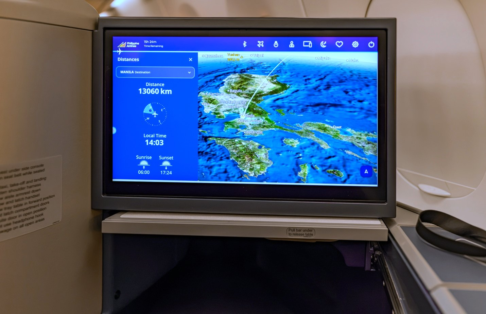

The biggest difference from the Super Diamond, as I said, is the door, shown below. The gap to the wall in front is manageable when it’s closed. Between you and the door is an armrest that can be lowered, with a water bottle holder inside.

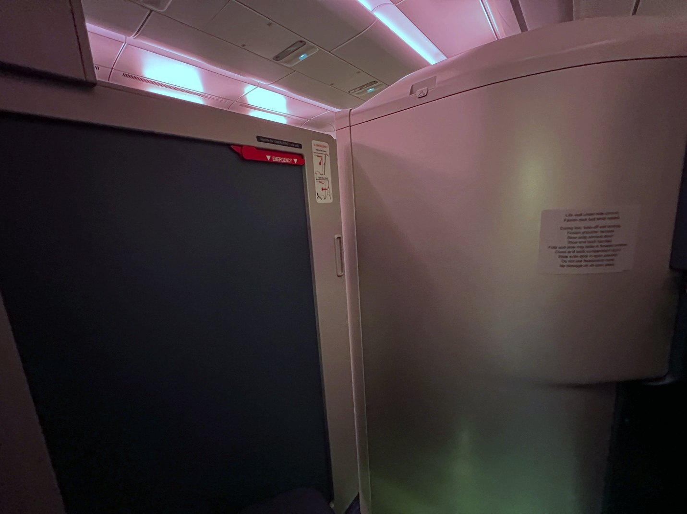

Wi-Fi was free for the whole flight for business class passengers. The login page called it a trial, though many airlines leave that “trial” label up permanently. Philippine Airlines emailed me to warn that Wi-Fi would be slow or unusable for about six hours over the polar regions. I appreciated the email, but it didn’t match my experience: for me, the Wi-Fi was unusable for the last three hours of the flight, roughly from China to the Philippines. (And no, that wasn’t because of Chinese airspace.)

## Amenities

When you board, a big bedding pouch is waiting on your seat. It holds a blanket, a mattress topper, a pair of rather flimsy slippers and the amenity kit. A pillow is provided separately, as are headphones, though I rarely use those on any flight.

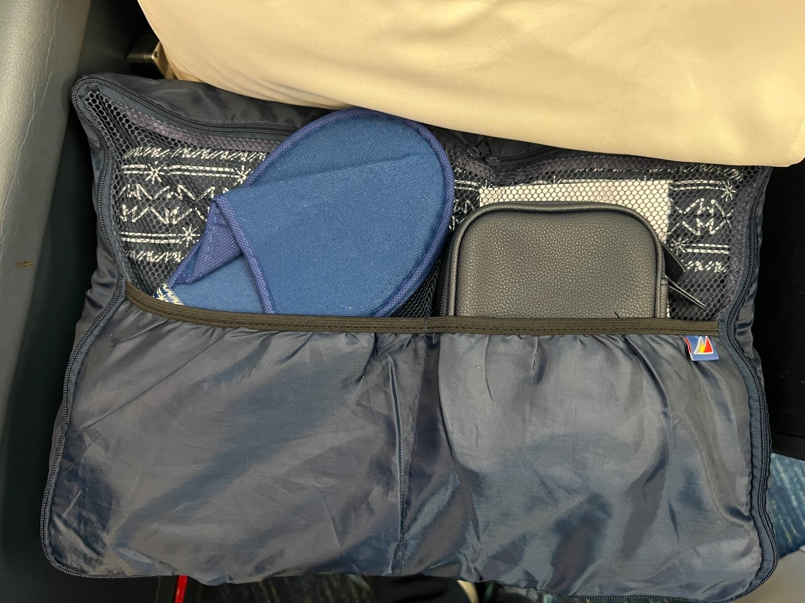

The amenity kit is made with L’Occitane and includes its lip balm, hand cream and face cream, plus a moisturizing wipe. There’s also a pair of socks, a dental kit, an eye mask and a comb.

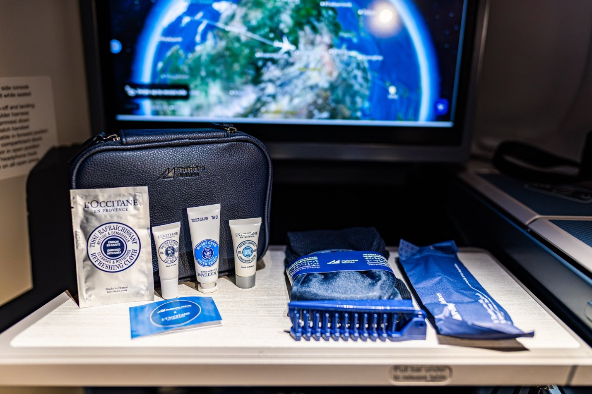

## Welcome and departure

Once I’d settled in, I was offered a welcome drink: orange juice, iced green tea or water. I picked the iced green tea, which was fine. A towel followed shortly after.

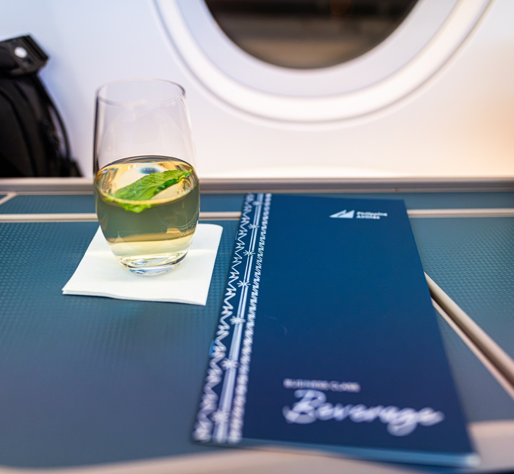

Soon after, the crew came to take my meal order. I told them I’d only been given a drinks menu, not a food menu, so they apologized and grabbed one from the empty seat behind me.

The safety video was rather interesting. These days most airlines work some of their own personality into the safety video, but Philippine Airlines went as far as giving it a full plot, which was entertaining. After a moderate taxi, we took off at 12:45 a.m., about five minutes behind schedule.

## Dinner

Dinner started about 40 minutes after takeoff. I understand that flights out of Manila are supposed to be a bit better for dining (preordering is only available outbound, and an amuse-bouche is served), but those small differences didn’t stop me from enjoying the meal.

Here are the dinner and mid-flight snack menu, plus the wine list. There were also cocktails, spirits and non-alcoholic drinks on offer.

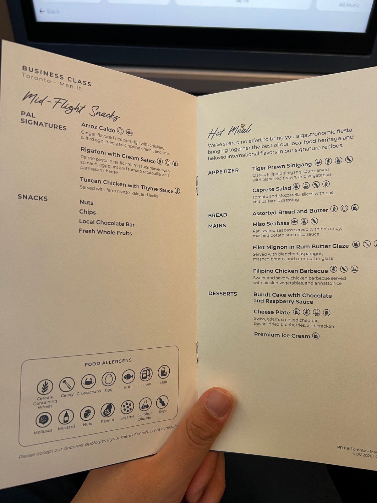

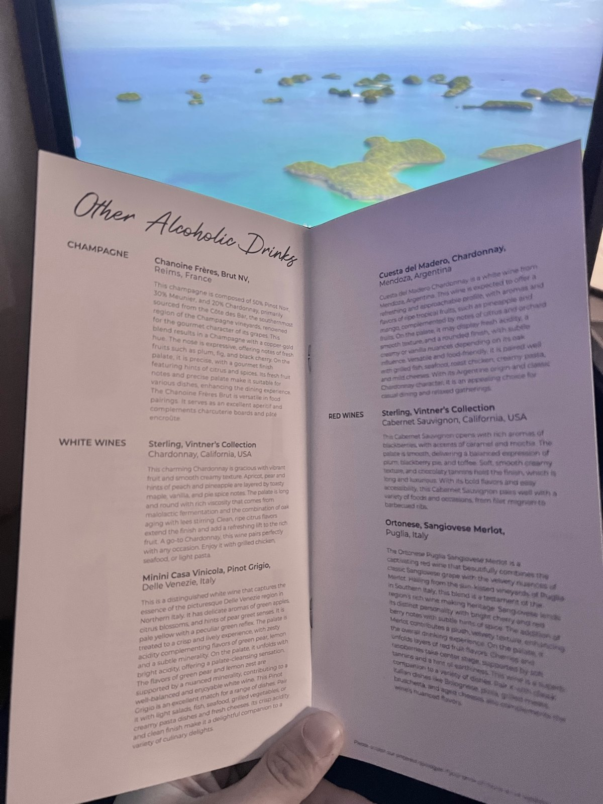

The meal started with the crew setting my table. Philippine Airlines serves dishes straight onto the table rather than on a tray (*very* appreciated!), but the table’s proportions let it down, especially with how the bread plate was placed. The crew put it lengthwise along the outer edge of the table rather than across the top, which costs the already long, narrow table even more precious width. I immediately moved it to the top of the table to make room for the dishes and my cutlery.

As mentioned, the service began with bread. Three options were offered from a basket, and I picked the garlic bread and a ciabatta. Both were warm, which was nice, though the ciabatta wasn’t as airy as a real one.

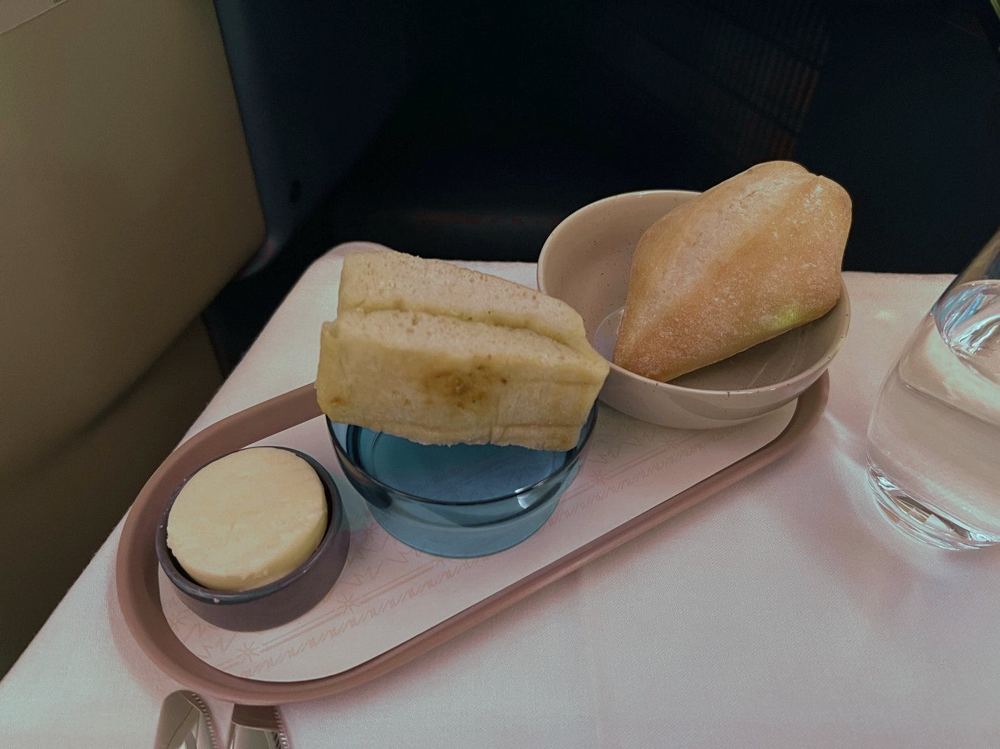

For the appetizer, I ordered the tiger prawn sinigang. I didn’t actually know what sinigang was, but I always try to order an airline’s home dishes, since they’re usually the most delicious. It turned out to be quite a sour soup, and since I like sour food, I found it very flavorful and umami, which helps a lot given our dulled sense of taste in the air.

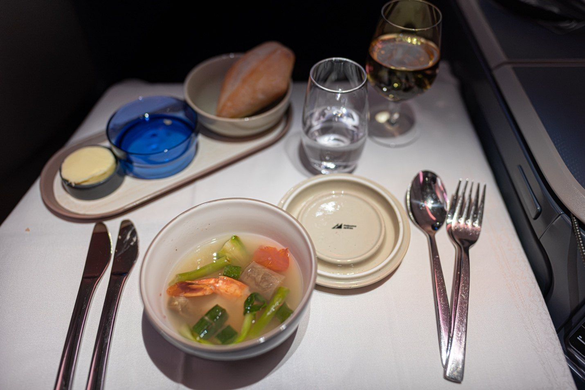

For the main course, I ordered the Filipino chicken barbecue. I hesitated for a moment, since chicken is harder to do well in the air than red meat. But Philippine Airlines truly excelled, serving what may be the best chicken I’ve had on a plane, and putting the dry chicken I’d had at the Centurion Lounge at LaGuardia earlier in the trip to shame. The chicken was flavorful and juicy, and the rice had a nice charred flavor too. The plating was also a delight to look at. A really nice job on the main course, Philippine Airlines.

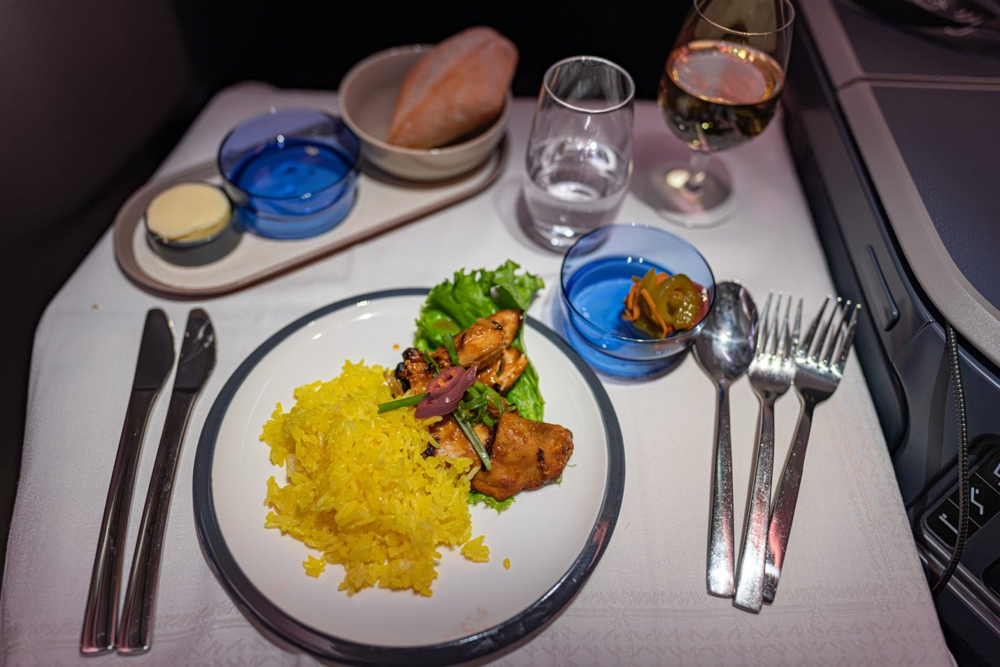

For dessert, I had the chocolate bundt cake, which was forgettable.

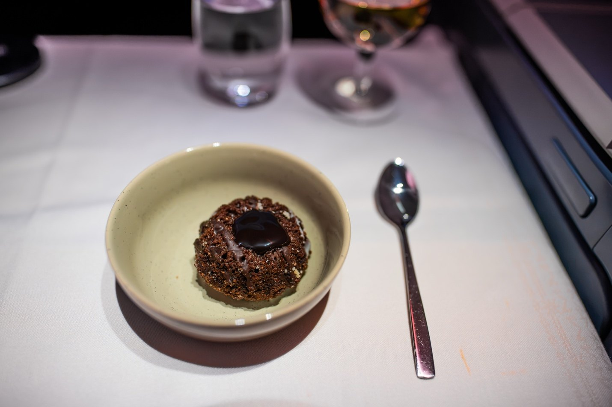

All in all, it was a really nice meal, and Philippine Airlines nailed both the presentation and the taste. The service wrapped up about an hour and a half into the flight.

## Sleep

After dinner, I quickly reclined my seat, closed my door and made my bed. The bedding was somehow full of static electricity while I was making the bed, which was awkward, but really nobody’s fault. The bed was comfortable, and I probably got the longest unbroken sleep I’ve ever had on a plane: about seven hours and 45 minutes. That would be great even on the ground!

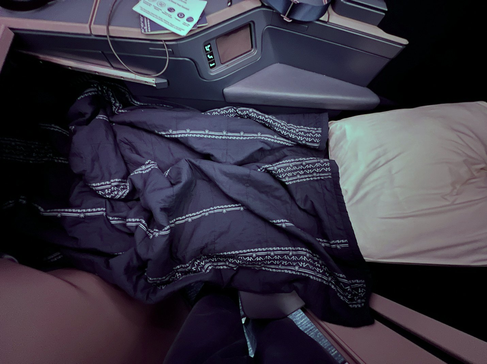

## The mid-flight snack

The mid-flight snack menu is above. When I woke up, I tried to use the call button to order, but quickly found that it didn’t work at my seat, whether on the screen or on the remote. So I walked to the galley to place my order instead.

I went for the arroz caldo, a rice porridge topped with spring onions, fried garlic and salted egg. The menu said it was made with chicken, though I wasn’t sure whether the meat was chicken or fish. The fried garlic and salted egg were authentic, though, so I mostly enjoyed it, especially right after waking up.

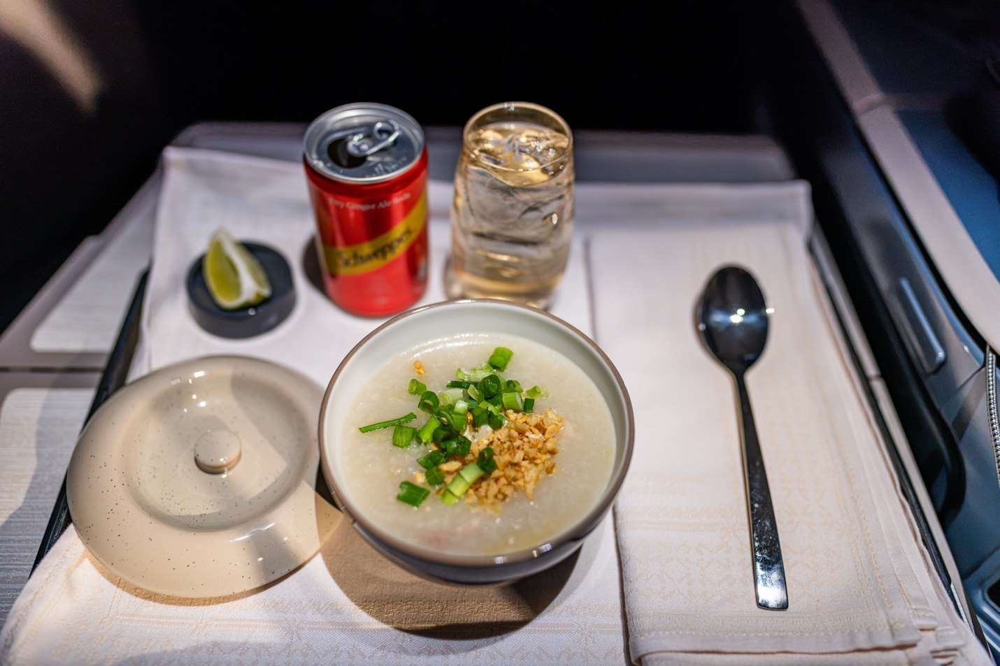

I tried to order a cocktail afterwards, but it never arrived. Then again, I fell asleep again shortly after finishing my snack, so I’m not sure whether they forgot it or just didn’t want to wake me.

## Breakfast

Breakfast started about two and a half hours before landing. Here’s the menu. I have to commend Philippine Airlines for an interesting and creative choice of mains, since airline breakfasts are too often boring (especially the Western options).

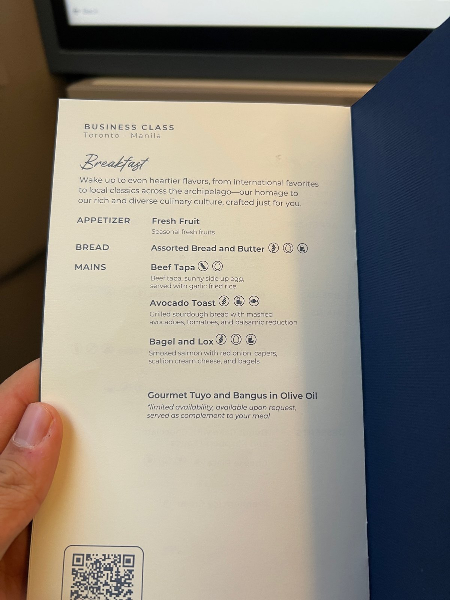

Breakfast began with a choice of orange juice or a mango smoothie, and I chose the smoothie. A warm towel followed shortly after.

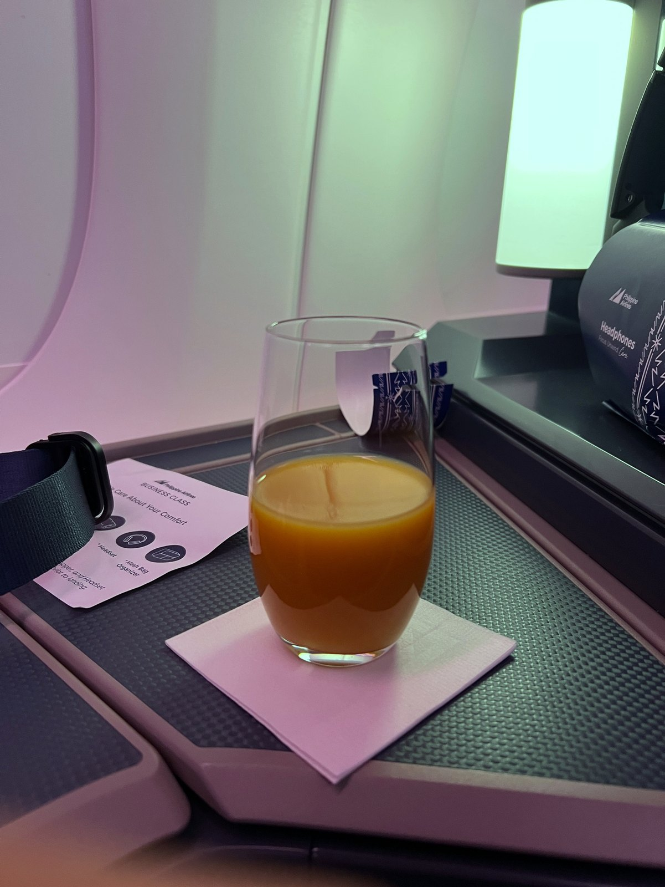

Next came the bread basket again, this time with different breads. I went for the (soft) croissant and a brioche bun, which were fine, though definitely not bakery standard. Ben from *One Mile at a Time* wrote that on his Philippine Airlines A350-1000 flight, the crew told him the cappuccino listed on the menu wasn’t actually available. I decided to try ordering one anyway, and to my surprise (Ben’s reviews are usually very accurate), the crew happily made me one. I also liked the nice mug it came in.

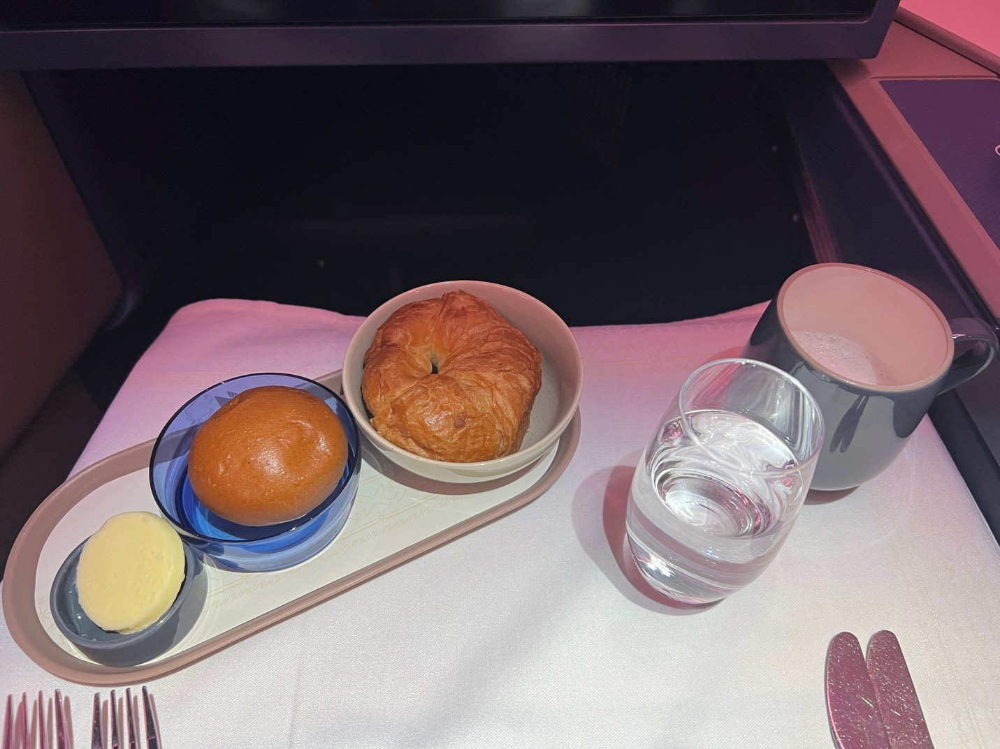

Then came a bowl of fruit.

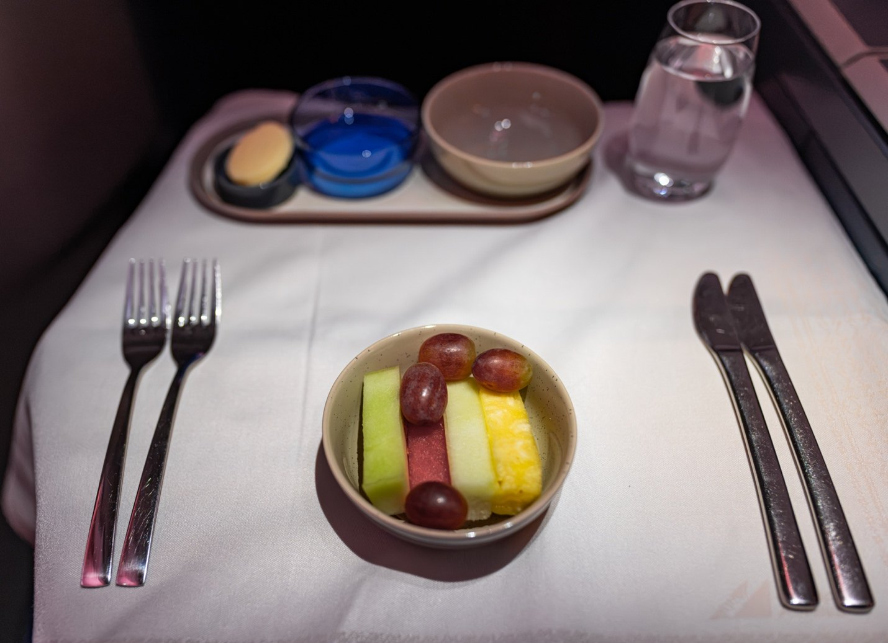

For the main, I ordered the beef tapa, which came with rice and a sunny-side-up (but hard) egg. I also ordered the tuyo and bangus (in the blue dish below), just to try them. The beef was again very flavorful, and the mildly spicy sauce went well with the rice. I’d hoped for a runny egg, but unless eggs are cooked on board (which only a few airlines do, in first class), that’s admittedly hard to pull off. The tuyo and bangus were nice to try, though nothing special.

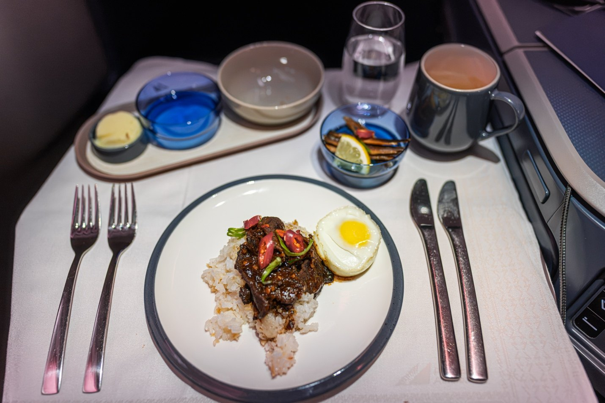

Breakfast finished with about an hour and a half to go to Manila. I liked this meal too, especially the main, which I’d happily have as a dinner main on a flight.

After breakfast, I asked for a glass of sparkling water and some chocolate. (If you know me in person, you’ll know I quite literally live on these two things!) The crew first offered me dark or milk chocolate, and I chose dark, but then they found they’d run out, so they offered me milk chocolate instead. I snacked on those for the rest of the flight.

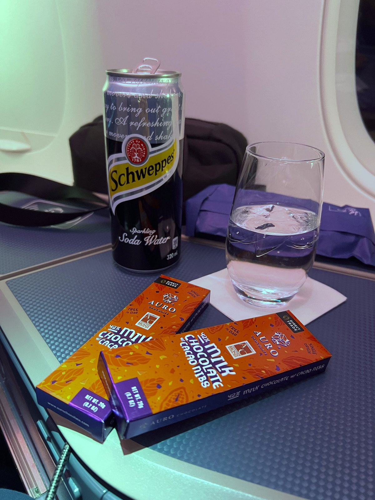

## Arrival and verdict

We landed at Manila’s Ninoy Aquino International Airport at about 5:15 a.m., almost 50 minutes ahead of schedule, and after a short taxi we parked at Terminal 1. From there, I made my way across the airport (which was also much better than I expected!) to Terminal 3 for my Cathay Pacific flight to Hong Kong.

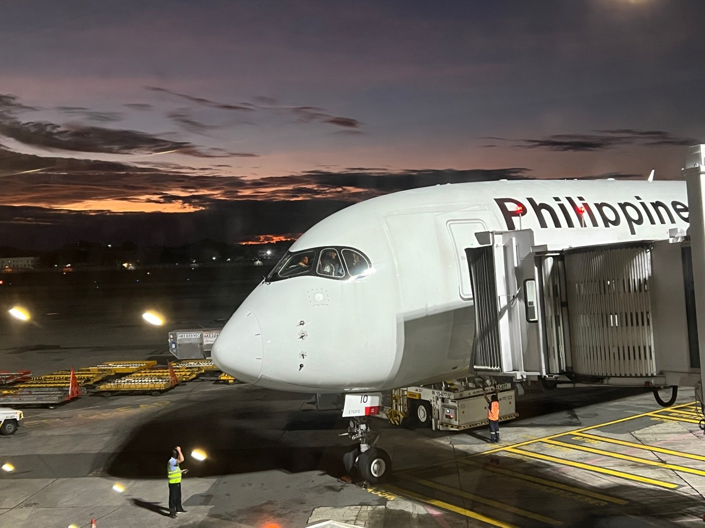

After my first-ever flight on Philippine Airlines, I can happily say it comfortably beat my expectations. The hardware was what I expected, but the airline really nailed every meal. A common problem in premium cabins these days is that the main course is often the least exciting part of the meal, while the appetizers and mid-flight snacks are the elaborate ones. Philippine Airlines, on the other hand, still makes the main course the highlight (which isn’t to say the rest was bad; it was still great), and I really appreciate that, since that’s what most people expect of any meal, in the air or in a restaurant. Philippine Airlines is set to join oneworld, and I’m delighted that I may soon have more chances to fly with them, and to enjoy my elite benefits when I do.
